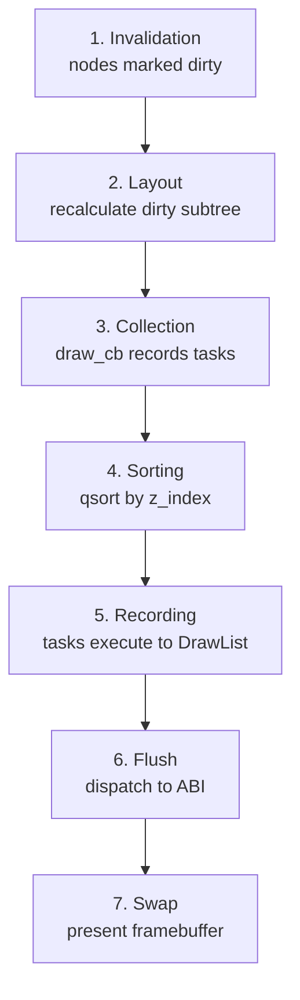

AromaUI uses deferred rendering. Instead of drawing immediately, widgets record commands into an `AromaDrawList`. At the end of each frame, commands are sorted by Z-index and flushed to the graphics backend.

## Frame Lifecycle



## DrawList Benefits

- **Z-sorting**: Nodes with higher `z_index` draw on top, regardless of tree order
- **Batching**: Multiple rectangles can be merged into a single `glDrawArrays` call
- **Frustum culling**: Offscreen nodes are skipped during collection

## Backend Interface

Drawing commands flow from the framework to the active graphics backend
automatically. As a widget author you only record into the DrawList; the
pipeline takes care of the rest.

```c
// Typical widget draw callback: record into the DrawList,
// the pipeline flushes it to the backend after Z-sorting.
void aroma_button_draw(AromaNode *node, size_t window_id) {
    AromaRect *r = aroma_node_get_rect(node);
    aroma_drawlist_cmd_fill_rect(list, r->x, r->y, r->width, r->height,
                                 bg_color, true, radius);
    aroma_drawlist_cmd_text(list, font, text, tx, ty, text_color);
}
```

## Backend Flush

Each frame the pipeline sends the buffered commands to the active
graphics backend (GLES3, Vulkan, or TFT_eSPI). On small TFT displays,
only the changed screen tiles are sent, which saves memory.

## Performance Characteristics

The GLES3 backend batches up to 256 shapes per draw call, which keeps
UIs with many simple rectangles fast. Glyph textures are cached
per-window (max 16 fonts); the least recently used font is evicted when
the cache is full.

## Controlling Rendering

Most rendering happens automatically, but you can influence it:

| Goal | How |
|---|---|
| Force a redraw | `aroma_ui_request_redraw(window)` marks the window dirty |
| Draw order | Higher `z_index` draws later (on top) |

## Next Steps

- Learn about [Animation](Animation-Engine.md) for smooth property transitions.
- Explore [Theming](Theming-and-Styling.md) for visual customization.
- See [Scene Graph](Scene-Graph-and-Node-System.md) for node lifecycle details.
